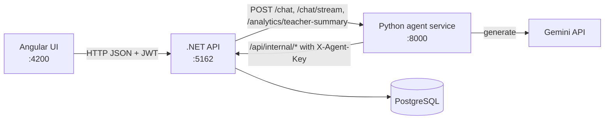

# System Overview

Status: MVP in development
Last updated: 2026-10-31
Audience: developers and coding agents working in this repository

This document describes what the system does, how its parts fit together, how requests flow, and how to run it. `CLAUDE.md` holds the binding engineering rules; `policy/` holds the binding agent behavior rules. If this document conflicts with either, they win and this document must be updated.

## 1. Purpose

Classly is an online learning platform with four roles: Admin, Teacher, Student and Parent. Students get an AI support bot that answers questions about the platform, cancels their subscription after explicit confirmation, and records concerns about their teachers. Admins see analytics of those concerns per teacher, with an AI-written summary on demand.

## 2. Capabilities

| Capability | Actor | Status |
|---|---|---|
| Registration and login with JWT (teacher, student, parent self-register; admin is seeded) | Everyone | Implemented |
| Users table and full user details (profile, family links, classes, concerns, audit) | Admin | Implemented |
| Teacher concern analytics: per-teacher totals, open, by category and severity, 30-day trend, AI summary, mark reviewed | Admin | Implemented |
| Classes: create, add or remove students by login | Teacher | Implemented |
| Link children by login, see their classes, subscribe a child | Parent | Implemented |
| Home with classes, teachers and subscription; subscribe | Student | Implemented |
| Support bot: help guide answers from `docs/SYSTEM.md` | Student | Implemented |
| Support bot: cancel own subscription after confirmation in a later turn | Student | Implemented |
| Support bot: report a concern about one of their teachers, classified by Gemini | Student | Implemented |
| Audit log of every write | System | Implemented |
| Human handoff queue | Admin | Planned |

## 3. Architecture

| Component | Path | Tech | Responsibility | Must not |
|---|---|---|---|---|
| Frontend | `frontend/` | Angular 20, standalone components, signals | Login, registration, role dashboards, student chat, admin analytics | Call the agent service or the database |
| Backend API | `backend/` | .NET 8, Clean Architecture, EF Core, JWT | Users, families, classes, subscriptions, concerns, analytics, audit, chat entry point, enforcement | Contain LLM prompts or agent reasoning |
| Agent service | `agents/` | Python, FastAPI, `google-genai` | Agent loop, orchestrator, help guide reader, concern classifier, teacher summary | Access the database or bypass the API |
| Policy | `policy/` | Markdown | Agent behavior rules with stable IDs | Contain code or secrets |

Backend layers: `Api -> Infrastructure -> Application -> Domain`, and `Api -> Application`. Domain and Application never reference EF Core, Identity or ASP.NET; password hashing (`IPasswordHasher`) and tokens (`ITokenService`) are Application abstractions implemented in Infrastructure.

## 4. Roles and Authentication

| Role | How created | Home route | Can |
|---|---|---|---|
| Admin | Seeded (`admin` / `admin`) | `/admin/users` | See all users and details, analytics, mark concerns reviewed, generate summaries |
| Teacher | Self-register | `/teacher/classes` | Manage own classes and enrollments |
| Parent | Self-register | `/parent/children` | Link children by login, see their classes, subscribe a linked child |
| Student | Self-register | `/student/home` | See classes and teachers, subscribe, use the support chat |

`POST /api/auth/login` and `/register` return `{token, user}`. The JWT carries `sub`, `login`, `name` and `role`; the frontend sends it as `Authorization: Bearer`. Role checks use `[Authorize(Roles = ...)]`; ownership checks (own class, linked child, own conversation, teacher of the student) live in Application services.

The agent service authenticates to `/api/internal/*` with the shared secret header `X-Agent-Key` (`AgentService:ApiKey` in the API, `AGENT_API_KEY` in `agents/.env`). The student's id, name and age reach the agent only from the API, taken from the JWT; a chat message can never set them.

## 5. Data Model

| Entity | Fields |
|---|---|
| `User` | `Id`, `Login` (unique, lowercase), `PasswordHash`, `Name`, `Age`, `Role` (`Admin`, `Teacher`, `Student`, `Parent`), `SubscriptionType` (0 none, 1 default), `CreatedAt` |
| `ParentChild` | `ParentId`, `ChildId` |
| `SchoolClass` | `Id`, `Name`, `Subject`, `TeacherId`, `CreatedAt` |
| `ClassEnrollment` | `ClassId`, `StudentId` |
| `TeacherConcern` | `Id`, `StudentId`, `TeacherId`, `ConversationId?`, `Text`, `Category`, `Severity`, `Summary`, `Status` (`New`, `Reviewed`), `CreatedAt` |
| `AuditEntry` | `Id`, `ActorUserId?`, `Actor` (login or `support-agent`), `Action`, `TargetUserId?`, `Details`, `CreatedAt` |
| `Conversation` | `Id`, `UserId`, `Title`, `UpdatedAt` |
| `ChatMessage` | `Id`, `ConversationId`, `Author` (`Customer` for the student, `Agent`), `Text`, `CreatedAt` |

Concern categories: `Communication`, `Fairness`, `TeachingQuality`, `LatenessOrAbsence`, `Behavior`, `Safety`, `Other`. Severities: `Low`, `Medium`, `High`, `Critical`.

Seed (`SeedData.cs`, applied on every startup; it only adds users, links, classes, enrollments and concerns that are missing; test passwords only):

| Role | Password | Logins |
|---|---|---|
| Admin | `admin` | `admin` |
| Teacher | `teacher` | `ms.harper` (Math 5A, English 5A), `mr.lee` (Science 7B, most concerns), `ms.patel` (History 6B, Art 4C), `mr.novak` (Geography 7A, includes a Critical safety concern), `ms.okafor` (Music 5B, Computer Science 8A) |
| Student | `student` | `emma`, `liam`, `noah`, `mia`, `ava`, `lucas`, `sofia`, `ethan`, `chloe`, `mason`, `zoe`, `oliver`, `lily`, `jack`, `ella`, `leo`, `grace`, `henry`, `amelia`, `ben` (ages 9 to 15; `noah`, `ethan`, `lily`, `henry` have no subscription) |
| Parent | `parent` | `anna` (emma, liam), `david` (noah, mia), `kate.brown` (ava, lucas), `maria.rossi` (sofia, ethan), `james.chen` (chloe, mason), `sarah.miller` (zoe, oliver), `peter.kim` (lily, jack), `laura.diaz` (ella, leo), `tom.evans` (grace, henry), `nina.white` (amelia, ben) |

## 6. Agent Design

| Agent | Prompt | Tools |
|---|---|---|
| Orchestrator | `agents/app/prompts/orchestrator.md` | `ask_help_guide`, `get_my_context`, `request_subscription_cancellation`, `confirm_subscription_cancellation`, `report_teacher_concern` |
| Help guide specialist | `docs_reader.md` | `read_help_guide` (`docs/SYSTEM.md`) |
| Concern classifier | `concern_classifier.md` | none; returns JSON `{category, severity, summary}` |
| Teacher summary | `teacher_summary.md` | none; returns `{summary, recommended_actions}` |

Loop: call the model, run requested tools, append results, repeat until the model answers without tool calls; the iteration cap is a safety net. Tool errors are structured `{category, retryable, message}`. Case facts (pending cancellation and similar) are kept per conversation outside the chat history and re-injected each turn.

Enforced in code:

| Rule | Where |
|---|---|
| Cancellation needs a pending request from an earlier turn and a confirmation in a later turn | Agent gate in `agents/app/tools/student_tools.py` |
| Only the student's own subscription can be cancelled; idempotent; audited | `SubscriptionService.CancelByAgentAsync` |
| A concern can only name a teacher who teaches the student | `ConcernService.ReportByAgentAsync` (403 otherwise) |
| Every write creates an `AuditEntry` | Application services |
| Safety or Critical concerns make the bot tell the student to talk to a parent or trusted adult now | Orchestrator prompt and `policy/04_safety_and_minors.md` |

## 7. API

| Method | Path | Role | Purpose |
|---|---|---|---|
| POST | `/api/auth/register` | anonymous | `{login, password, name, age, role}` → `{token, user}` |
| POST | `/api/auth/login` | anonymous | `{login, password}` → `{token, user}` |
| GET | `/api/me` | any | Current user |
| POST | `/api/me/subscription` | Student, Parent | `{childId?}`; student subscribes self, parent a linked child |
| GET | `/api/me/classes` | Student | Classes with teachers and classmates |
| GET, POST | `/api/me/children` | Parent | List `{child, classes}[]`; link `{childLogin}` |
| DELETE | `/api/me/children/{childId}` | Parent | Unlink |
| GET | `/api/users?role=` | Admin | `UserDto[]` |
| GET | `/api/users/{id}` | Admin | `{user, parents, children, classes, concerns, audit}` |
| GET, POST | `/api/classes` | Admin, Teacher, Student / Teacher | Visible classes / create `{name, subject}` |
| POST | `/api/classes/{id}/students` | Teacher (owner) | Enroll `{studentLogin}` |
| DELETE | `/api/classes/{id}/students/{studentId}` | Teacher (owner) | Remove |
| GET, POST | `/api/conversations` | Student | Own conversations / create |
| GET, POST | `/api/conversations/{id}/messages` | Student | Messages / one chat turn |
| POST | `/api/conversations/{id}/messages/stream` | Student | Chat turn as SSE: `delta {text}`, `done`, `error {message}` |
| GET | `/api/analytics/teachers` | Admin | `{totalConcerns, openConcerns, highOrCriticalConcerns, byCategory, teachers[]}` |
| GET | `/api/analytics/teachers/{id}` | Admin | `{stats, concerns}` |
| POST | `/api/analytics/teachers/{id}/summary` | Admin | `{summary, recommendedActions, generatedAt}`; 502 if the agent service is down |
| PATCH | `/api/concerns/{id}` | Admin | `{status: "New" \| "Reviewed"}` |
| GET | `/api/internal/students/{id}/context` | agent key | `{id, name, age, subscriptionType, teachers[{teacherId, teacherName, classId, className, subject}]}` |
| POST | `/api/internal/students/{id}/subscription/cancel` | agent key | `{studentId, subscriptionType, changed}` |
| POST | `/api/internal/concerns` | agent key | `{studentId, teacherId, conversationId?, text, category, severity, summary}` |
| GET | `/health` | anonymous | API health |

Errors are RFC 9110 problem details: 400 validation, 401 login or token, 403 role or ownership, 404, 409 conflict, 502 agent unavailable.

Agent service: `POST /chat` and `/chat/stream` take `{conversation_id, message, user: {id, name, age}}`; `POST /analytics/teacher-summary` takes `{teacher_name, concerns[{text, category, severity, created_at}]}`.

## 8. Running Locally

| Service | Command | URL |
|---|---|---|
| Backend | `cd backend && dotnet run --project src/MlhSupport.Api` | http://localhost:5162, Swagger at `/swagger` |
| Frontend | `cd frontend && npm install && npm start` | http://localhost:4200 |
| Agents | `cd agents && source .venv/bin/activate && uvicorn app.main:app --reload --port 8000` | http://localhost:8000 |

| File | Key | Purpose |
|---|---|---|
| `backend/src/MlhSupport.Api/secrets.json` | `ConnectionStrings:Default` | PostgreSQL connection |
| `secrets.json` | `Jwt:Key` | JWT signing key, at least 32 characters |
| `secrets.json` | `AgentService:ApiKey` | Shared agent key, same value as `AGENT_API_KEY` |
| `agents/.env` | `GEMINI_API_KEY`, `GEMINI_MODEL` | Model access |
| `agents/.env` | `API_BASE_URL`, `AGENT_API_KEY` | How the agent reaches `/api/internal/*` |
| `frontend/src/environments/environment.ts` | `apiUrl` | Default `http://localhost:5162/api` |

Never commit `secrets.json`, `.env` or keys.

## 9. Testing

| Level | Location | Covers |
|---|---|---|
| Backend unit | `backend/tests/MlhSupport.Application.Tests` | Auth, family and class permissions, subscription cancel and audit, concern ownership, analytics aggregation, conversation ownership |
| Agent unit | `agents/tests` | Agent loop, help guide, cancellation gate, concern flow, injection attempts, backend adapter, analytics endpoint |
| Frontend | `cd frontend && npm run build` | Type checks |

## 10. Known Gaps

| Gap | Impact |
|---|---|
| Agent conversation history and case facts are in memory | Lost when the agent service restarts |
| No human handoff queue yet | Safety concerns are recorded and flagged in analytics but not routed to a person |
| No password reset or account editing | Admin cannot change users from the UI |
