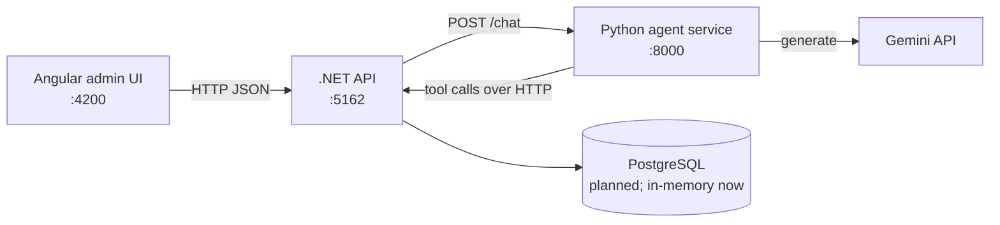
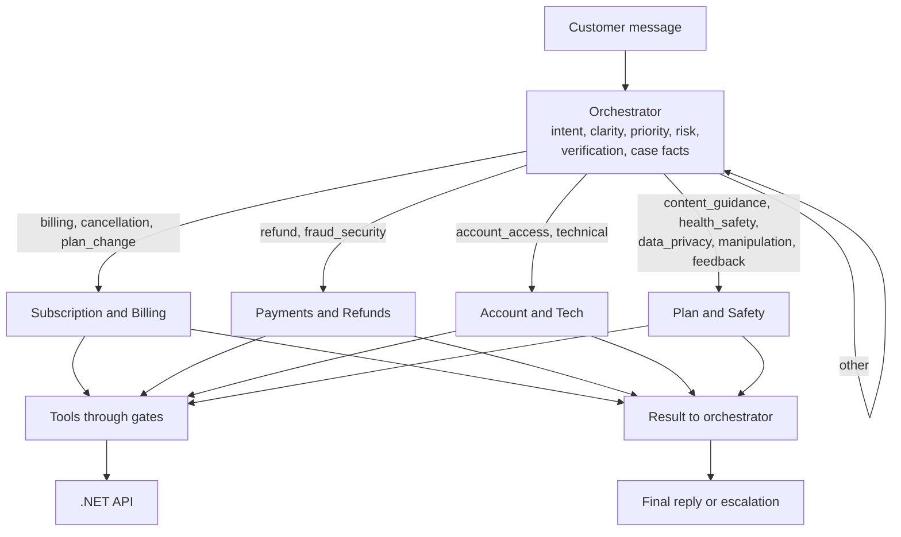
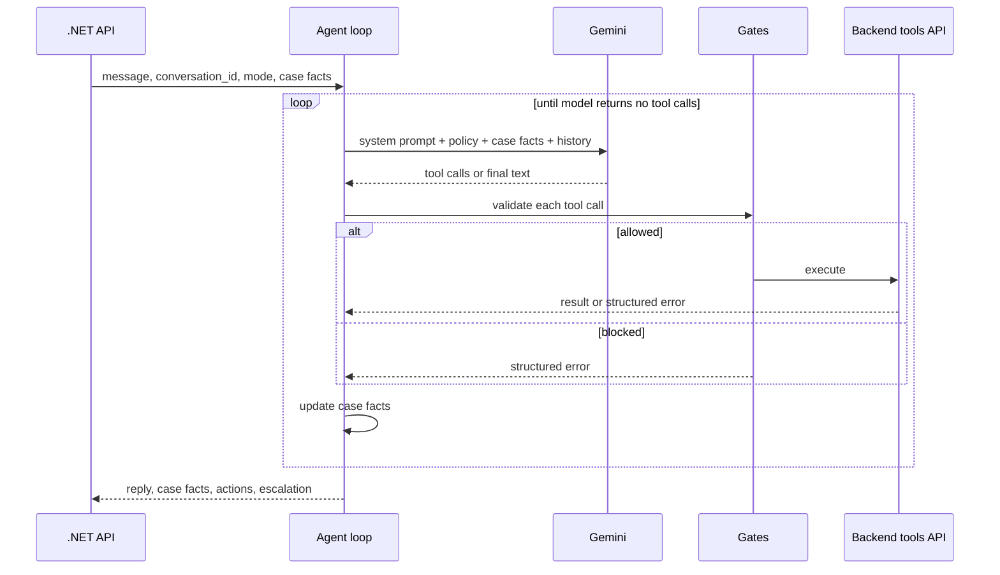

# System Overview

Status: MVP in development
Last updated: 2026-10-31
Audience: developers and coding agents working in this repository

This document describes what the system does, how its parts fit together, how requests flow, and how to run and use it. `CLAUDE.md` holds the binding engineering rules; `policy/` holds the binding agent behavior rules. If this document conflicts with either, they win and this document must be updated.

## 1. Purpose

An AI support operations assistant for Leaply, a wellness and habit-building app. The AI does not only answer: it understands the customer's real goal, executes allowed actions through tools, escalates to humans with a ready-to-use handoff, assists human agents, and reviews conversation quality.

Hackathon mapping:

| Challenge requirement | System capability |
|---|---|
| Understand the request and the real goal | Intent analysis, clarity levels C1 to C4, hedged-fact handling (`policy/01_intent_understanding.md`) |
| Propose or initiate actions | Tool-using agent loop with autonomy tiers and code-enforced gates |
| Help support agents decide | Copilot mode and structured handoff with recommended action and draft reply |
| Analyze interactions and evaluate support | QA mode scoring, churn risk, root cause (`policy/09_copilot_and_qa.md`) |

## 2. Capabilities

| Capability | Actor | Status |
|---|---|---|
| Client table and client details in admin UI | Support staff | Implemented (in-memory seed data) |
| Customer support chat with orchestrator and sub-agents | Customer | Planned |
| Autonomous resolution of 🟢 and 🟡 cases | Agent | Planned |
| Escalation queue with structured handoffs | Support staff | Planned |
| Copilot recommendations on tickets | Support staff | Planned |
| Conversation quality review | Support lead | Planned |
| Audit log of write actions and security flags | System | Planned |
| Staff authentication (Admin, SupportAgent) | Support staff | Planned |

## 3. Architecture



| Component | Path | Tech | Responsibility | Must not |
|---|---|---|---|---|
| Frontend | `frontend/` | Angular 20, standalone components | Admin UI: clients, chat, handoff queue | Call the agent service or the database directly |
| Backend API | `backend/` | .NET 8, Clean Architecture | Business data, business rules, authoritative enforcement (gates, limits, audit), chat entry point | Contain LLM prompts or agent reasoning |
| Agent service | `agents/` | Python, FastAPI, `google-genai` | Agent loop, orchestrator and sub-agents, policy loading, tool adapters | Access the database; bypass the API |
| Policy | `policy/` | Markdown | Agent behavior rules with stable IDs | Contain code or secrets |

Backend layers and allowed references:

```
Api -> Infrastructure -> Application -> Domain
Api -> Application
```

| Layer | Contains | Never references |
|---|---|---|
| `MlhSupport.Domain` | Entities, enums, domain rules | Anything else |
| `MlhSupport.Application` | Use cases, DTOs, repository abstractions | EF Core, Identity, ASP.NET |
| `MlhSupport.Infrastructure` | Repositories, EF Core, Identity | Api |
| `MlhSupport.Api` | Controllers, DI composition, CORS, Swagger | Domain entities in responses |

## 4. Repository Map

```
CLAUDE.md                       engineering rules for agents and developers
.claude/rules/code-style.md     no code comments, English only
.claude/launch.json             run configurations: api, frontend
docs/SYSTEM.md                  this document
policy/                         agent behavior policy, see policy/README.md
backend/MlhSupport.sln
backend/src/MlhSupport.Domain/Entities/Customer.cs
backend/src/MlhSupport.Domain/Enums/SubscriptionStatus.cs
backend/src/MlhSupport.Application/Customers/CustomerService.cs
backend/src/MlhSupport.Application/Customers/CustomerDto.cs
backend/src/MlhSupport.Application/Abstractions/ICustomerRepository.cs
backend/src/MlhSupport.Infrastructure/Persistence/InMemoryCustomerRepository.cs
backend/src/MlhSupport.Api/Controllers/CustomersController.cs
backend/tests/MlhSupport.Application.Tests/
agents/app/main.py              FastAPI app, /health
agents/app/agents/              orchestrator and sub-agents
agents/app/api/                 HTTP endpoints of the agent service
agents/app/core/                agent loop, ModelClient, settings, case facts
agents/app/policy/              policy loader and prompt assembly
agents/app/tools/               tool definitions and backend adapters
agents/tests/
frontend/src/app/core/          API models and services
frontend/src/app/features/      clients, chat
```

## 5. Agent Design

### 5.1 Modes

| Mode | Counterpart | Allowed tool classes | Output |
|---|---|---|---|
| `customer` | Customer | All; Write within autonomy tier | Chat replies |
| `copilot` | Human agent | Identity, Read, Knowledge, Internal | Structured recommendation (COP rules) |
| `qa` | Support lead | Read, Knowledge | Structured review (QA rules) |

The mode is set by the API per request. A message cannot change it.

### 5.2 Orchestrator and Sub-Agents



Routing, per-agent tools and policy files are defined in `policy/README.md`, section Sub-Agent Routing. The orchestrator owns verification, case facts and the final handoff. Several issues in one message stay in one loop with shared case facts.

### 5.3 Autonomy Tiers

| Tier | Behavior | Examples |
|---|---|---|
| 🟢 GREEN | Automatic | Next payment info, cancellation steps, turn off auto-renewal, resend verification email, troubleshooting, bug ticket |
| 🟡 YELLOW | Automatic with check or limit | Refund within policy up to 100 USD, duplicate charge, plan change, pause, multiple accounts |
| 🔴 RED | Human only; agent gathers facts and escalates | Chargeback or legal threat, unmatched charge, health and safety, data deletion, refunds beyond policy, manipulation |

### 5.4 Agent Loop



| Rule | Detail |
|---|---|
| Exit | The loop ends when the model returns a final answer with no tool calls. The iteration cap is a safety net only. |
| Model access | Behind a `ModelClient` interface; Gemini implementation via `google-genai`. |
| Case facts | Stored outside chat history, re-injected every turn, updated after every tool call. |
| Tool output | Trimmed to fields relevant to the issue before being added to context. |
| Errors | Every tool returns `{category, retryable, message}` on failure. Categories are listed in `policy/07_tools_and_errors.md`. |

### 5.5 Enforcement in Code

Prompt rules are probabilistic. These are enforced by the .NET API and mirrored in the agent gates:

| Gate | Rule | Behavior when violated |
|---|---|---|
| Verification | SEC-01 | Write and account Read tools return `verification_required` |
| Confirmation | ESC-01 | Write tools without a confirmation token from the latest customer turn return `confirmation_required` |
| Refund cap | REF-10 | `process_refund` above 100 USD returns `limit_exceeded` |
| Red tier | COR-09 | Write tools in a case marked 🔴 return `policy_blocked` |
| Mode | TOOL-07 | Tools outside the mode's classes return `permission_denied` |
| Idempotency | TOOL-05 | Repeated write with the same idempotency key is rejected |
| Audit | SEC-12 | Every write and `flag_security` call is logged with conversation, tool, arguments, result, rule ID |

### 5.6 Tools

| Class | Tools |
|---|---|
| Identity | `verify_customer`, `find_accounts` |
| Read | `get_customer`, `get_subscription`, `get_invoices`, `get_usage` |
| Write | `subscribe`, `cancel_subscription`, `change_plan`, `process_refund` |
| Support | `resend_verification_email`, `create_bug_ticket` |
| Knowledge | `get_policy`, `search_help_center` |
| Internal | `escalate_to_human`, `add_internal_note`, `flag_security` |

Signatures, usage conditions and error handling: `policy/07_tools_and_errors.md`.

## 6. End-to-End Flows

### 6.1 Customer Chat

1. Customer sends a message in the chat UI.
2. Angular calls `POST /api/conversations/{id}/messages` on the .NET API.
3. The API loads conversation state and case facts, sets `mode=customer`, and forwards to the agent service.
4. The orchestrator analyzes intent, clarity, priority and risk, verifies the customer when needed, and routes each issue to a sub-agent.
5. Sub-agents call tools; the API enforces gates and writes audit entries.
6. Before any write, the agent summarizes the action and asks for explicit confirmation; the next customer turn carries the confirmation.
7. The agent returns a reply, updated case facts, executed actions and an optional handoff.
8. The API stores the turn and, on escalation, creates a handoff in the queue.

### 6.2 Vague Request

1. Clarity is C2 or C3 (`policy/01_intent_understanding.md`).
2. Hedged facts become search ranges (INT-20 to INT-27).
3. After verification, the agent looks up data first and asks the customer to confirm what it found.
4. At most one question per message and two clarification rounds per issue; then the agent proposes options or escalates.

### 6.3 Escalation

1. Trigger: customer asks for a human, 🔴 tier, policy gap, no progress, or authority exceeded (ESC-10).
2. The agent resolves what it can, then calls `escalate_to_human` with the handoff schema from `policy/08_confirmation_escalation_state.md`.
3. The handoff contains customer, verified flag, priority, issues, facts, steps taken, rule IDs, recommended action and draft reply.
4. The customer is told a specialist has the case and the response time from `get_policy("response_time")`.
5. Staff pick it up in the handoff queue, optionally run copilot mode, and act.

### 6.4 Copilot

1. A support agent opens a ticket and requests a recommendation.
2. The API calls the agent service with `mode=copilot`.
3. The agent returns summary, interpretations, recommended action with rule IDs, risks, missing info and a draft reply. It never executes Write or Support tools.

### 6.5 Quality Review

1. A support lead selects a closed conversation.
2. The API calls the agent service with `mode=qa`, transcript, tool log and case facts.
3. The agent returns scores QA-01 to QA-07, policy violations, churn risk, root cause and one improvement suggestion.

## 7. API

### 7.1 Implemented

| Method | Path | Service | Response |
|---|---|---|---|
| GET | `/api/customers` | .NET | `CustomerListItemDto[]`: `id, fullName, email, plan, subscriptionStatus` |
| GET | `/api/customers/{id}` | .NET | `CustomerDetailsDto`: adds `nextPaymentDate, nextPaymentAmount, createdAt`; 404 if missing |
| GET | `/health` | Python | `{"status": "ok"}` |

### 7.2 Planned

Target contracts. The conversation endpoints match the `ChatApi` contract on branch `il-basic-front-app` (`frontend/src/app/core/chat/`); they implement the chat entry point described as `/api/chat` in `CLAUDE.md`. Once implemented, the code and Swagger become the source of truth and this table must be updated.

| Method | Path | Service | Purpose |
|---|---|---|---|
| GET | `/api/conversations` | .NET | Conversation list: `Conversation[]` (`id, title, lastMessage, updatedAt`) |
| POST | `/api/conversations` | .NET | Create a conversation: `{}` → `Conversation` |
| GET | `/api/conversations/{id}/messages` | .NET | Messages: `ChatMessage[]` (`id, author: customer \| agent, text, createdAt`) |
| POST | `/api/conversations/{id}/messages` | .NET | Customer chat turn: `{text}` → agent `ChatMessage` |
| POST | `/chat` | Python | Agent turn: `{conversation_id, mode, message, history, case_facts}` → `{reply, case_facts, actions, handoff?}` |
| GET | `/api/handoffs` | .NET | Escalation queue |
| POST | `/api/handoffs/{id}/copilot` | .NET | Copilot recommendation for a ticket |
| POST | `/api/conversations/{id}/review` | .NET | QA review of a closed conversation |
| GET | `/api/audit` | .NET | Audit log |
| * | `/api/tools/*` | .NET | One endpoint per tool in section 5.6, called only by the agent service |

## 8. Data Model

Implemented:

| Entity | Fields |
|---|---|
| `Customer` | `Id`, `FullName`, `Email`, `Plan`, `SubscriptionStatus` (`None`, `Trial`, `Active`, `Cancelled`, `Paused`), `NextPaymentDate`, `NextPaymentAmount`, `CreatedAt` |

Required by the policy and not yet modeled:

| Entity or field | Needed for |
|---|---|
| `Subscription.Source` (`web`, `app_store`, `google_play`) | BIL-01 to BIL-05, REF-30, REF-31 |
| `Subscription.CancelledAt`, `RenewalAt`, `TrialEndsAt` | BIL-11, REF-02, REF-05 |
| `Invoice` (date, amount, currency, status, card last 4, refunded amount) | REF-01 to REF-12, SEN-20 to SEN-24, BIL-50 to BIL-53 |
| `Customer.Region`, `SignInMethod` | REF-06 to REF-08, ACC-01, ACC-03 |
| `UsageSummary` | REF-13, churn risk |
| `Conversation`, `Message`, `CaseFacts` | Agent loop state |
| `Handoff` | Escalation queue |
| `AuditEntry` | SEC-12 |
| `SecurityFlag` | SEC-22, SEN-23, SEN-24 |

Seed data should cover every scenario in `policy/10_examples.md`.

## 9. Running Locally

Prerequisites: .NET 8 SDK, Node.js 20+, Python 3.12, a Gemini API key.

| Service | Command | URL |
|---|---|---|
| Backend | `cd backend && dotnet run --project src/MlhSupport.Api` | http://localhost:5162, Swagger at `/swagger` |
| Frontend | `cd frontend && npm install && npm start` | http://localhost:4200 |
| Agents | `cd agents && python -m venv .venv && .venv\Scripts\activate && pip install -r requirements.txt && uvicorn app.main:app --reload --port 8000` | http://localhost:8000 |

On macOS or Linux use `source .venv/bin/activate`.

Configuration:

| File | Key | Purpose |
|---|---|---|
| `agents/.env` (copy of `.env.example`) | `GEMINI_API_KEY` | Model access |
| `agents/.env` | `BACKEND_API_URL` | Default `http://localhost:5162/api` |
| `frontend/src/environments/environment.ts` | `apiUrl` | Default `http://localhost:5162/api` |
| `backend/src/MlhSupport.Api/Program.cs` | CORS origin | `http://localhost:4200` |

Never commit `.env`, keys or `appsettings.Local.json`.

## 10. Using the System

| Screen | Route | What you can do | Status |
|---|---|---|---|
| Clients | `/clients` | See all customers with plan and subscription status | Implemented |
| Client details | `/clients/:id` | See all stored data for a customer | Implemented |
| Support chat | `/chat` | Talk to the support agent as a customer | Placeholder; chat UI with a mock API on branch `il-basic-front-app` |
| Handoff queue | planned | Review escalations, run copilot, act | Planned |
| Quality review | planned | Score conversations, see violations and churn risk | Planned |

Demo scenarios: use the use cases in `policy/10_examples.md`, at least one per tier (🟢, 🟡, 🔴), one vague message, and one prompt-injection attempt.

## 11. Testing

| Level | Location | Covers |
|---|---|---|
| Backend unit | `backend/tests/MlhSupport.Application.Tests` | Use cases, gates, refund rules |
| Agent unit | `agents/tests` | Gates, case facts, tool adapters, policy loading, with a fake `ModelClient` |
| Scenario | `agents/tests` | Every example in `policy/10_examples.md`: expected tool calls, blocked actions, escalation reason |

A scenario test passes when the expected rule IDs are applied, no hard rule is broken, and the gates block every forbidden write.

## 12. Working Rules for Agents

1. Read `CLAUDE.md` and `.claude/rules/code-style.md` before changing code. No code comments, English only.
2. Respect the dependency rules in section 3; never add a reference against them.
3. Business rules and enforcement live in the .NET API. The Python service never accesses the database.
4. Agent behavior changes go into `policy/` with a rule ID, not into code or ad-hoc prompts. Update `policy/README.md` version when policy changes.
5. Any new tool must be added in `policy/07_tools_and_errors.md`, the sub-agent routing table in `policy/README.md`, the API, and section 5.6 of this document.
6. Every new behavior needs a scenario test.
7. Update the Status columns in this document when a planned item is implemented.
8. Build order and progress: `CLAUDE.md`, Build order.

## 13. Known Gaps

| Gap | Impact |
|---|---|
| Seed plans (`Yoga Monthly`, `Wellness Annual`, `Meditation Monthly`) do not match Leaply programs | Demo realism |
| No purchase source, invoices or region in the data model | Billing and refund rules cannot run |
| Chat, agent loop, tools and gates not implemented | Core capability missing |
| No authentication on API | Staff endpoints are open |
| Policy values marked as assumptions: 100 USD refund limit, 30-day deletion, 3 to 7 day pending release | Must be confirmed before production |
