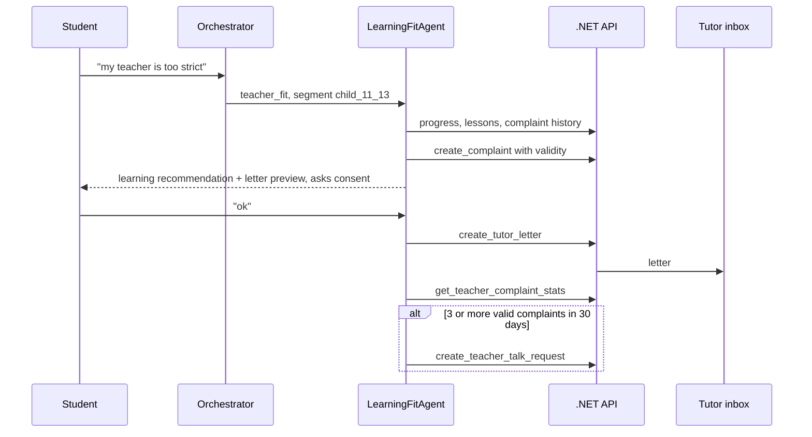

# Tutoring Platform: Project Overview

Status: Proposal, replaces the Leaply scope after team approval
Last updated: 2026-10-31
Audience: developers and coding agents working in this repository
Agent behavior rules: `policy/tutoring/AGENT_POLICY.md`

This document describes the new product scope, the capabilities in priority order, and what changes in each part of the current system. Until the migration is done, `CLAUDE.md`, `docs/ARCHITECTURE.md` and `policy/` still describe the running Leaply system.

## 1. Product

An online learning platform where children and teenagers take lessons with teachers. Each student has a tutor, a staff curator who follows their learning and talks to teachers. Parents pay; client managers handle subscriptions and cancellations.

| Role | Uses the AI for | Receives work from the AI |
|---|---|---|
| Student | Complaints about a teacher, learning help, "I want to quit" | — |
| Parent or grandparent | Complaints, progress, cancellation | — |
| Teacher | Own lessons and own aggregated feedback | — |
| Tutor | — | Letters about one student, requests to talk with a teacher |
| Client manager | — | Cancellation handoffs with summary |
| Support lead | Analytics, salary review input, approval of learning proposals | Reviewer flags |

## 2. Capabilities in Priority Order

| # | Capability | What the AI does | Output | Policy |
|---|---|---|---|---|
| 1 | Student says the teacher does not fit | Checks progress and lessons, gives a learning recommendation from test results, infers the teaching style the student needs (supportive, direct, structured, interactive), drafts a letter to the tutor with consent. When valid complaints about one teacher repeat, creates a request for the tutor to talk with the teacher | Learning recommendation, tutor letter, teacher talk request | FIT |
| 2 | Parent wants to cancel | Finds the reason, gathers facts, writes a summary, offers to connect with a client manager now, later, or in writing | Client manager handoff | MGR |
| 3 | Complaint validity | Checks lessons, attendance, notes, test trends and history; assigns confirmed, partially confirmed, unconfirmed or cannot verify | Validity status with evidence | VAL |
| 4 | Tone per audience | Uses segment guides: child 7–10, child 11–13, teen 14–17, parent, grandparent, teacher. New segments and guide changes come from learning proposals | Consistent tone | TONE |
| 5 | Trust | Transparency, consent before sharing, no overpromising, no pressure | — | TRUST |
| 6 | Analytics and salary review | Complaint counts and rates per period, teacher, subject, type and validity; factual salary review input per teacher | Reports | ANA, SAL |
| 7 | Reviewer sub-agent | Reviews every closed conversation, scores decisions, records which allowed decision works better; playbook ranks decisions by outcome; rule changes go to a human | Learning signals, playbook, proposals | REV, LEARN |

Safeguarding is not a capability to prioritize; it overrides all of them.

## 3. Key Decisions

| Decision | Reason |
|---|---|
| The agent never cancels, refunds or changes subscriptions; a client manager does | Team requirement; keeps commercial talks with humans |
| Validity affects what a complaint counts toward, never whether the child is heard | A child with weak results can still have a real problem |
| Safeguarding reports skip validity checks | A credibility filter must never hide a danger signal |
| Teachers are never told who complained | Protects children and trust |
| Salary review gives facts, not pay amounts | Pay is a human decision |
| Learning ranks decisions already allowed by policy; new rules need approval | The agent must not loosen its own limits |
| Role and segment come from the session, not from the message | Prevents a child from acting as a parent |

## 4. Changes to the Current System

### 4.1 Agents (`agents/`)

| Today | Change |
|---|---|
| `OrchestratorAgent` with `ask_help_guide` tool and `prompts/orchestrator.md` for Leaply | Orchestrator classifies role, segment, category and priority, then delegates. New prompt built from `policy/tutoring/AGENT_POLICY.md` |
| `DocsReaderAgent` reads `docs/SYSTEM.md` (Leaply help guide) | Keep the pattern; replace the guide with a tutoring help guide |
| One sub-agent | Sub-agents: `LearningFitAgent` (FIT, VAL), `ClientManagerHandoffAgent` (MGR), `SafetyAgent` (SAFE, SEC), `ReviewerAgent` (REV, LEARN), `AnalyticsAgent` (ANA, SAL) |
| `/chat`, `/chat/stream` take `conversation_id` and `message` | Add `session` with `user_id`, `role`, `segment`, `student_id` supplied by the .NET API |
| Tools are local | Tools call the .NET API through adapters in `agents/app/tools/` |
| No post-conversation step | `ReviewerAgent` runs after a conversation closes |

### 4.2 Backend (`backend/`)

New domain entities:

| Entity | Key fields |
|---|---|
| `Family` | Id, plan, renewal date, remaining lessons, client manager |
| `Student` | Id, family, name, age, segment, tutor, teachers |
| `Teacher` | Id, name, subjects, style tags |
| `Tutor` | Id, name, students |
| `Lesson` | Id, student, teacher, start, duration, attendance, notes |
| `TestResult` | Id, student, subject, topic, score, date |
| `Complaint` | Id, student, teacher, type, text summary, style need, validity, evidence, created at |
| `TutorLetter` | Id, student, tutor, body, consent at, status |
| `TeacherTalkRequest` | Id, teacher, tutor, complaint ids, summary, status |
| `ManagerHandoff` | Id, family, manager, summary, contact choice, status |
| `SafeguardingFlag` | Id, student, teacher, evidence, status |
| `LearningSignal` | Id, conversation, situation type, decision, outcome, scores |
| `PlaybookEntry` | Situation type, decision, cases, success rate |
| `ToneProfile` | Segment, guide text, version |

Endpoints: one per tool in policy section 14 under `/api/tools/*`, plus staff endpoints for tutor inbox, manager queue, safeguarding queue, analytics and learning proposals. The API enforces role and mode per tool (SEC-01) and logs every action.

Existing `Customer` becomes `Family`; `Conversation` gains `UserId`, `Role`, `Segment`, `ClosedAt`.

### 4.3 Frontend (`frontend/`)

| Screen | Purpose |
|---|---|
| Chat with a session picker | Demo as a student (11), a teen (15), a parent, a grandparent or a teacher |
| Tutor inbox | Letters and teacher talk requests |
| Client manager queue | Cancellation handoffs with summary |
| Analytics | Complaints per period, teacher, type and validity; salary review per teacher |
| Learning | Reviewer scores, playbook ranking, proposals waiting for approval |

### 4.4 Documentation

| File | Change |
|---|---|
| `CLAUDE.md` | Product scope, sub-agents, tools |
| `docs/ARCHITECTURE.md` | Capabilities, flows, data model |
| `docs/SYSTEM.md` | Tutoring help guide in the same XML format |
| `policy/` | Leaply files archived; `policy/tutoring/` becomes the active policy |

## 5. Flows

### 5.1 Student complaint

### 5.2 Parent cancellation

Parent asks to cancel → reason → facts → summary → contact choice → `handoff_to_client_manager` → parent told who replies and when.

### 5.3 Review and learning

Conversation closes → `ReviewerAgent` scores QA-01 to QA-06 and names a better allowed decision if any → `log_learning_signal` → playbook ranking updates after enough cases → rule or tone changes become proposals → support lead approves → new policy version.

## 6. Plan

| Step | Scope | Demo value |
|---|---|---|
| 1 | Seed data: 3 families, 5 students across segments, 4 teachers (one with repeated complaints), tutors, lessons and tests for October | Realistic data |
| 2 | Session picker in chat; session passed to the agent | Tone per segment |
| 3 | Read tools and `create_complaint`, `create_tutor_letter`, `create_teacher_talk_request` | Capability 1 and 3 |
| 4 | `handoff_to_client_manager` and manager queue | Capability 2 |
| 5 | Safeguarding tools | Safety demo |
| 6 | Complaint analytics page | Capability 6 |
| 7 | Reviewer sub-agent and learning page | Capability 7 |
| 8 | Scenario tests for E01 to E07 | Technical execution |

Demo script: E01 student strict teacher → E02 repeated complaints create a talk request → E03 parent cancellation to manager → E04 grandparent tone → analytics page → reviewer page.

## 7. Open Questions

| Question | Draft |
|---|---|
| Platform name | Not set |
| Is "tutor" a staff curator separate from the teacher | Yes in this draft |
| Threshold for a teacher talk request | 3 different students, 30 days |
| Age bands for tone | 7–10, 11–13, 14–17 |
| Does salary review include positive feedback | Yes |
| Playbook minimum sample | 10 cases per decision |
| How a grandparent is identified | Family relation field; self-description for tone only |
